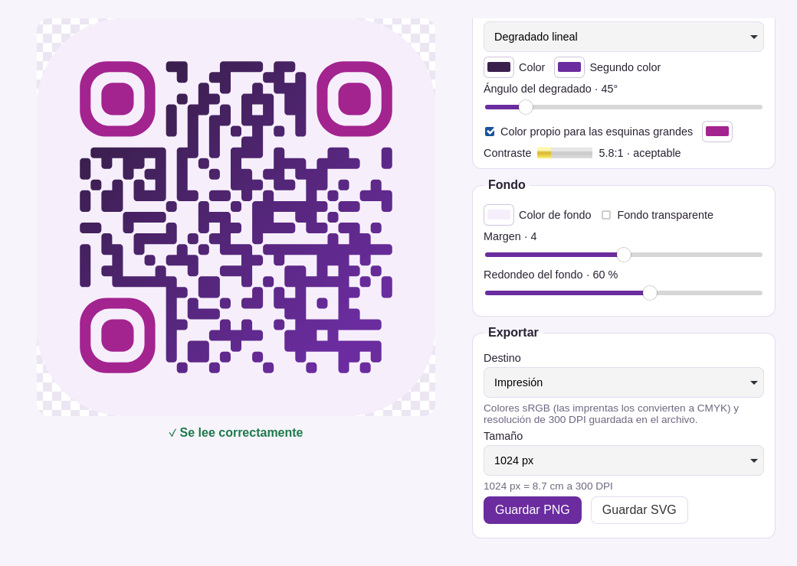

# QR Libre

QR codes that never expire. Free, no accounts, no servers.



[Español más abajo](#español)

## Why it never expires

A QR code is an open standard: the pattern stores **your link itself**, and any camera can read it without asking anyone. Many "free" generators do something else: they create a *dynamic* code that points to a link on **their** server, which then redirects to your page. When the trial ends or the service shuts down, they cut the redirect and your code stops working, even if it's already printed.

QR Libre only makes static codes. They work for as long as your page exists, and depend on neither this app nor anyone else.

## Download

1. Go to [the latest release](https://github.com/starworn/qr-libre/releases/latest) and download `qr-libre-vX.Y.Z-windows-x64.exe`.
2. Double-click it. Nothing to install.

Requires **Windows 10 or 11**. It does not run on Windows 7 or 8.

### "Windows protected your PC"

The first time, Windows may show that blue warning. It appears because the program has no digital signature: signing costs money every year, and this is a free project. To open it:

1. Click **More info**.
2. Click **Run anyway**.

<!-- SmartScreen screenshot: add after the first Windows test -->

If you'd rather not trust an executable, you can read the code and build it yourself (see below).

## Usage

1. Paste your link.
2. Adjust the shape, colours and background. The preview updates live.
3. Watch the indicator below the code: **✓ Scans correctly** means the app read it successfully. If it shows **⚠**, lower the rounding or raise the contrast.
4. Click **Save PNG** or **Save SVG**.

Tips:
- Modules must be **darker** than the background. The other way round (light on dark) fails on many phones.
- Leave a margin around the code (4 is the standard). Below 2 it may fail when placed on top of an image.
- A **transparent background** is meant for light surfaces.
- **SVG** is vector: it prints at any size without pixelating. Use it for cards, stickers or banners.
- **Reset** brings the style back to plain black on white (your link is kept).
- The app opens in Spanish or English depending on your system language; the button at the top switches it.

## Colour and print

- PNGs embed the **sRGB** colour profile, so they look the same in any browser, phone or editor.
- With the **Print** destination, the PNG also stores **300 DPI** and the app shows the physical size (e.g. 2048 px = 17.3 cm). SVGs are saved in millimetres.
- Very saturated (neon) colours look duller on paper; the app warns you.
- **Why no CMYK export?** Converting to CMYK properly needs *each* print shop's own ICC profile. A generic one usually does worse than letting the print shop convert. Send them the sRGB PNG or SVG: that's what they expect.

## Example: the "carriecatt" preset

The ready-made example in [`deliverables/carriecatt/`](deliverables/carriecatt/) (with and without background) uses a palette taken from the avatar of illustrator **Carrie Catt**. Check out her work at [carriecatt.carrd.co](https://carriecatt.carrd.co).


## Building from source

You need [Node.js](https://nodejs.org) (LTS) and [Rust](https://rustup.rs), plus the [Tauri prerequisites](https://tauri.app/start/prerequisites/) for your system.

```bash
npm ci
npm test                      # tests, including the generate → decode round-trip
npm run tauri dev             # run the app in development mode
npm run gallery               # example gallery in gallery/index.html
npx tauri build --no-bundle   # executable in src-tauri/target/release/
```

On Linux with NVIDIA + Wayland, use `./launch.sh`, which sets `WEBKIT_DISABLE_DMABUF_RENDERER=1` to avoid a WebKitGTK crash.

To publish a version, push a `v*` tag (e.g. `v0.2.0`): GitHub Actions builds the `.exe` on Windows and attaches it to the release.

Issues and pull requests are welcome, and so are forks.

---

## Español

**Códigos QR que no caducan. Gratis, sin cuentas y sin servidores.**

**¿Por qué no caduca?** Un QR es un estándar abierto: los cuadritos guardan *tu enlace mismo*. Muchos generadores "gratuitos" crean en cambio códigos *dinámicos* que apuntan a su servidor y te redirigen; cuando se acaba la prueba, cortan la redirección y tu QR impreso deja de funcionar. QR Libre solo hace códigos estáticos, que funcionan mientras exista tu página.

**Descargar:** baja `qr-libre-vX.Y.Z-windows-x64.exe` de [la última versión](https://github.com/starworn/qr-libre/releases/latest) y dale doble clic. No hay que instalar nada. Requiere Windows 10 u 11. Si Windows muestra "Windows protegió su PC" (el programa no está firmado porque firmarlo cuesta dinero cada año), haz clic en **Más información → Ejecutar de todos modos**.

**Uso:** pega tu enlace, ajusta forma, colores y fondo, revisa que el indicador diga **✓ Se lee correctamente** y haz clic en **Guardar PNG** o **Guardar SVG**. Los cuadritos deben ser más oscuros que el fondo y conviene dejar un margen de al menos 2 (4 es el estándar). El fondo transparente es para superficies claras. El SVG es vectorial, así que se imprime a cualquier tamaño. **Restablecer** regresa el estilo a negro sobre blanco.

**Color e impresión:** los PNG llevan el perfil sRGB. El destino *Impresión* además guarda 300 DPI y muestra el tamaño físico; el SVG se guarda en milímetros. No hay exportación CMYK: hacerlo bien requiere el perfil ICC de cada imprenta, así que mándales el archivo sRGB y que ellos lo conviertan.

**Ejemplo:** el preset "carriecatt" usa la paleta del avatar de la ilustradora **Carrie Catt** — conoce su trabajo en [carriecatt.carrd.co](https://carriecatt.carrd.co).

**Compilar:** `npm ci`, `npm test`, `npm run tauri dev` (Linux NVIDIA+Wayland: `./launch.sh`), `npm run gallery`, `npx tauri build --no-bundle`. Subir un tag `v*` compila y publica el `.exe` de Windows con GitHub Actions.

## License / Licencia

[MIT](LICENSE)
